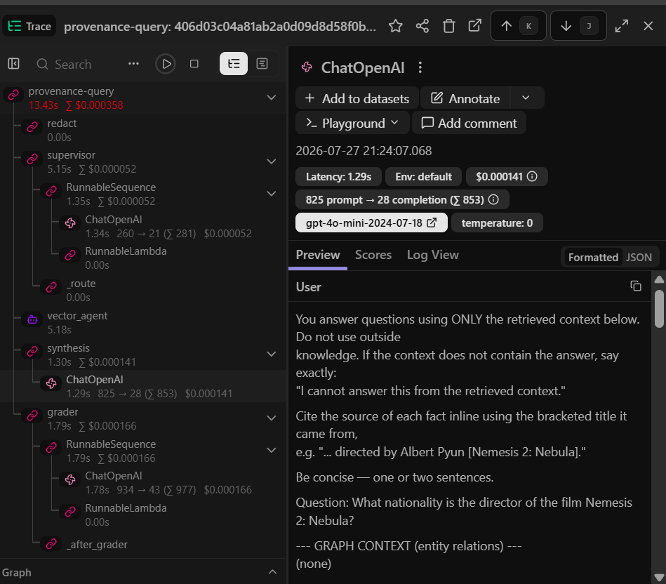
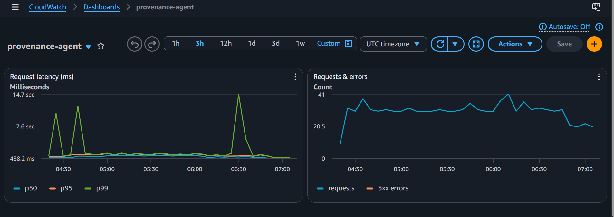
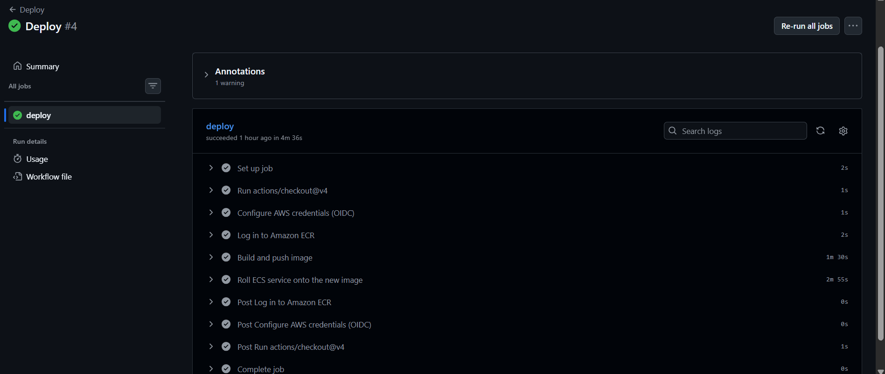
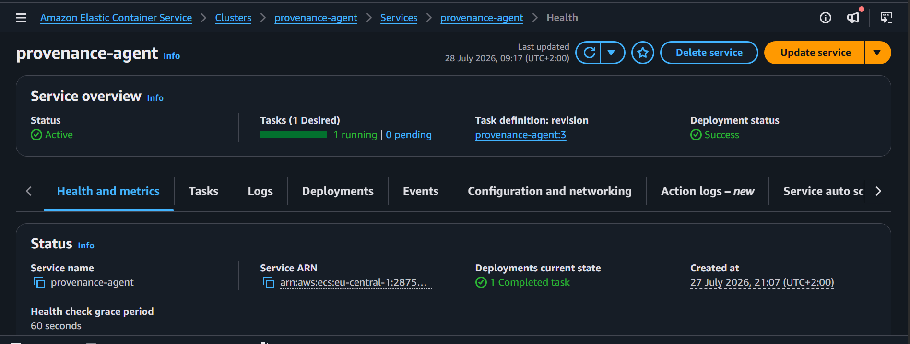

# ProvenanceAgent

[](https://github.com/munyaradzi-zhou/provenance-agent/actions/workflows/ci.yml)
[](https://opensource.org/licenses/MIT)


A **production-deployed, multi-agent RAG service** that answers multi-hop
questions over a knowledge graph + vector store, returns its reasoning trace,
and scores its own answer faithfulness.

> Built to demonstrate the full production loop that AI Engineer roles ask for:
> agentic orchestration (LangGraph), deployment (AWS ECS/Fargate), observability
> (Langfuse + CloudWatch), evaluation-in-CI (RAGAS), and responsible-AI handling
> (Presidio PII redaction).

---

## The problem

Flat vector RAG breaks on **compositional questions** — where the answer requires
linking several facts that never co-occur in one chunk (*"What nationality is the
director of the film Nemesis 2: Nebula?"* needs film → director → nationality).
ProvenanceAgent routes each query through a **supervisor agent** that decides
between graph traversal (Neo4j/Cypher) and semantic retrieval (Qdrant), then a
**synthesis agent** composes an answer, and a **grader** checks it against the
retrieved context — retrying with broader retrieval if the answer isn't grounded.
Every response carries citations, a faithfulness verdict, and a visible reasoning
trace.

Corpus: **2WikiMultihopQA** — a standard multi-hop QA benchmark (1,896 graph
entities / 1,259 relations in Neo4j; 3,463 passage vectors in Qdrant).

## Architecture

```
Client → API Gateway (HTTPS) → ALB → FastAPI (ECS Fargate)
                                         │
                                    redact (Presidio PII)
                                         │
                                 LangGraph supervisor  ◄──┐ bounded repair loop
                                   ┌─────┴─────┐          │ (grade → retry)
                             graph agent   vector agent   │
                             (Neo4j)       (Qdrant)       │
                                   └─────┬─────┘          │
                                    synthesis agent       │
                                         │                │
                                       grader ────────────┘
                                         │
                    Langfuse trace + CloudWatch EMF → response
```

Full diagram and node responsibilities: [`docs/architecture.md`](docs/architecture.md).
Threat model + responsible-AI posture (OWASP-LLM mapping, PII handling):
[`docs/threat_model.md`](docs/threat_model.md).

## Results

Measured on the live AWS deployment before teardown. RAGAS scores over 12 curated
multi-hop questions; agent vs. a flat-vector baseline (top-k → answer, no graph,
no routing) — the thing the agent is claiming to beat.

| Metric                          | **Agent** | Flat-vector baseline |
| ------------------------------- | --------- | -------------------- |
| Faithfulness (RAGAS)            | **0.65**  | 0.53                 |
| Answer relevancy (RAGAS)        | **0.63**  | 0.47                 |

The agent wins on both — the quantified proof of the thesis. Not by a landslide,
which is the honest story: on some questions the graph lacked the path and fell
back to vector. That nuance is more credible than a suspiciously perfect number.

**Latency & cost** (CloudWatch EMF, ~2h45m live traffic — **1,013 requests, 0 errors**):

| Metric                | Value                                              |
| --------------------- | -------------------------------------------------- |
| p50 latency           | ~825 ms (488–1,071 ms range)                       |
| p95 latency           | ~1,193 ms                                          |
| p99 latency           | ~1.3 s typical; cold-start spikes to 14.7 s        |
| Avg cost / query      | ~$0.00036 (gpt-4o-mini, from Langfuse cost tracking) |
| Infra cost            | ~$2–4 / day live; `terraform destroy` → $0         |

> **Reading the latency spread:** p50–p95 are dominated by the ALB's cheap
> `/ready` health-check pings; the real `/v1/query` agentic calls (up to 4
> sequential LLM calls each) surface at the tail (~10–15 s, the cold-start
> spikes). An aggregate latency number is meaningless without the request mix —
> for a real SLO you'd emit a separate metric dimension per route.

### Live evidence

Captured from the running AWS deployment (see [`docs/screenshots/`](docs/screenshots/)).

<p align="center">
  <br>
  <em>Langfuse — one <code>/v1/query</code> traced node-by-node (routing, dual retrieval, synthesis, grading) with per-node tokens · latency · cost.</em>
</p>

<p align="center">
  <br>
  <em>CloudWatch — live latency percentiles, request count, and errors (1,013 requests, 0 errors over ~2h45m).</em>
</p>

<p align="center">
  <br>
  <em>GitHub Actions — the OIDC deploy pipeline green end-to-end (assume role → ECR push → ECS force-new-deployment → services-stable). No long-lived AWS keys.</em>
</p>

<p align="center">
  <br>
  <em>ECS Fargate — the service running one healthy task behind the ALB.</em>
</p>

## Quickstart (local, from a clean clone)

```bash
# 1. env — copy the template and add at minimum OPENAI_API_KEY.
#    Local defaults point at the compose Neo4j/Qdrant; leave API_KEYS empty to
#    disable auth for local dev.
cp .env.example .env

# 2. bring up the API + Neo4j + Qdrant
docker compose up -d --build

# 3. ingest the corpus into the freshly-started stores (one-time)
#    (fetch data/raw first per data/README — 2WikiMultihopQA)
python -m app.ingest            # builds graph (Neo4j) + vectors (Qdrant)

# 4. ask a multi-hop question
curl -X POST localhost:8000/v1/query \
  -H "Content-Type: application/json" \
  -d '{"question": "What nationality is the director of the film Nemesis 2: Nebula?"}'
```

Response includes the answer, citations, the route the supervisor chose, the
grounded/faithfulness verdict, the reasoning trace, and request-id + latency.

> When `API_KEYS` is set (as in the deployed stack), every request must send
> `-H "X-API-Key: <key>"`. The live endpoint is HTTPS-only via API Gateway.

**Required env keys:** `OPENAI_API_KEY` (LLM + embeddings). Everything else has a
working local default in `.env.example`; `NEO4J_*`, `QDRANT_*`, `LANGFUSE_*` are
only needed when pointing at managed/cloud services.

## Demo

<p align="center">
  
</p>

A compositional question answered live over HTTPS: the request is rejected
without an API key, then with a key the supervisor routes to **both** graph +
vector retrieval, synthesises a cited answer, and the grader confirms it's
grounded — all with a visible reasoning trace. Raw transcript:
[`docs/demo_transcript.md`](docs/demo_transcript.md). _(3-min Loom walkthrough: TBD.)_

## Tech stack

- **Orchestration:** LangGraph (supervisor + worker agents, bounded repair loop)
- **Retrieval:** Neo4j (graph, read-only-guarded text-to-Cypher), Qdrant (vector)
- **API:** FastAPI (API-key auth, rate limiting, request timeout, structured logs)
- **Eval:** RAGAS as a CI gate (faithfulness threshold + flat-vector baseline)
- **Observability:** Langfuse (per-node traces, token/cost), CloudWatch (EMF metrics + dashboard/alarms)
- **MLOps:** MLflow (eval run history), DVC + S3 (data/prompt versioning)
- **Deploy:** Docker → AWS ECR → ECS Fargate + ALB + API Gateway + Secrets Manager, all via Terraform
- **Responsible AI:** Microsoft Presidio PII redaction (see [threat model](docs/threat_model.md))

## Cost & teardown

The full stack runs ~$2–4/day. All infra is Terraform-managed and disposable:

```bash
terraform -chdir=infra destroy   # removes everything → $0
```

Managed stores use free tiers (Neo4j AuraDB Free + Qdrant Cloud Free); an AWS
Budget alarm is the safety tripwire.

## What I'd do next

- Separate latency metric dimensions per route (`/v1/query` vs health checks) for a real SLO.
- GitHub OIDC → CI `terraform apply` (no long-lived AWS keys); currently manual.
- Reversible name tokenisation so `PERSON`/`LOCATION` can be redacted *and* restored post-retrieval.
- Larger eval set + context precision/recall metrics; per-question error analysis.

## License

MIT
