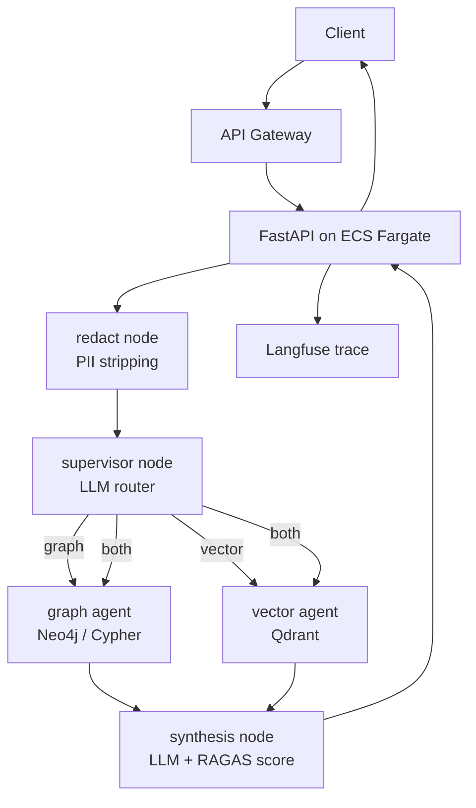
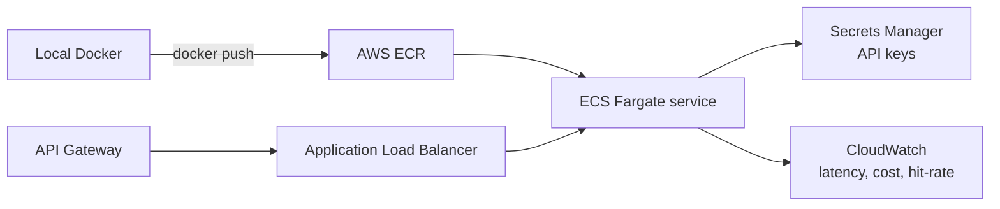

# Architecture

## Request flow

## Node responsibilities

| Node         | Does                                                   |
| ------------ | ------------------------------------------------------ |
| redact       | Presidio strips contact/financial PII before anything sees the text (see [threat_model.md](threat_model.md)) |
| supervisor   | LLM decides graph / vector / both + logs why           |
| graph agent  | generates Cypher, queries Neo4j, formats context       |
| vector agent | embeds question, searches Qdrant, optional re-rank     |
| synthesis    | LLM combines context → answer; computes faithfulness  |

## AWS deployment target (weeks 3–4)

Start with **ECS Fargate** (no cluster management) rather than EKS/Kubernetes.
Add EKS only if a target role specifically demands hands-on Kubernetes — Fargate
proves the deployment competency for most of the postings.

## Observability & MLOps 

- **Langfuse** — every `/query` produces a full trace (each node, tokens, latency).
- **RAGAS in CI** — `app/eval/run_eval.py` runs on push; fails the build if
  faithfulness drops below threshold. This is the "evaluation obsession" signal.
- **MLflow** — log each experiment run (prompt version, model, eval scores).
- **DVC** — version the prompt templates and `eval_set.jsonl` so eval is reproducible.
