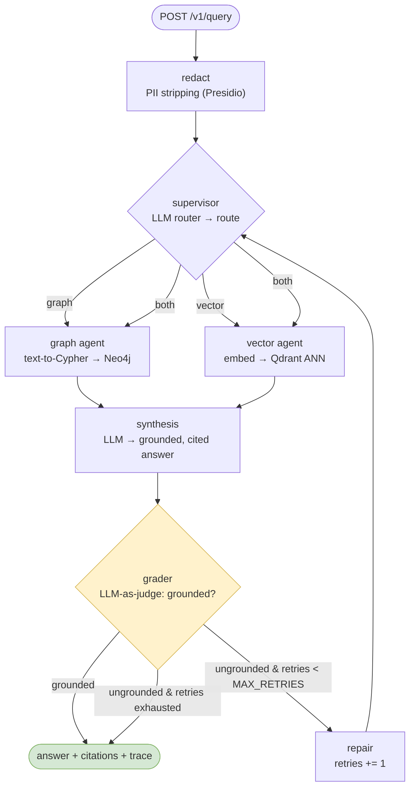
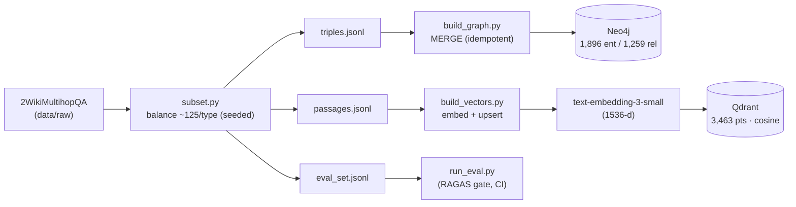
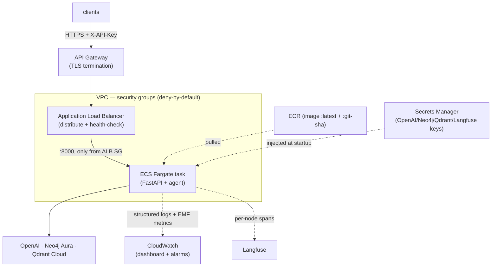

# Architecture

A production multi-agent RAG service: an LLM supervisor routes each question to a
knowledge graph (Neo4j) and/or a vector store (Qdrant), a synthesis step writes a
grounded, cited answer, and a grader checks it — with a bounded repair loop. See also
[`schema.md`](schema.md) (data model) and [`threat_model.md`](threat_model.md) (security).

## 1. The agent graph (query-time)

The full LangGraph lifecycle for one `/v1/query`, including the grader and the bounded
repair loop (`app/agents/graph.py`):

### Node responsibilities

| Node | Does | LLM? |
| ---- | ---- | ---- |
| redact | Presidio strips contact/financial PII **before anything sees the text** (first node, by design) | no |
| supervisor | routes graph / vector / both + records why (`RouteDecision`); deterministic fallback on LLM error; broadens to `both` on a repair retry | yes |
| graph agent | generates read-only Cypher, queries Neo4j, formats context; degrades to empty context on failure | yes (text-to-Cypher) |
| vector agent | embeds the question, ANN-searches Qdrant (top-k); degrades to empty context on failure | embeds |
| synthesis | combines context → concise answer with inline `[title]` citations, grounded strictly in context | yes |
| grader | LLM-as-judge checks every claim against the context (`GroundingVerdict`); fails **open** on error | yes |
| repair | increments the retry counter; supervisor broadens retrieval next pass | no |

The loop is bounded by `MAX_RETRIES` (default 1), so one request makes 3 LLM calls on the
happy path and at most ~6 with a repair — cost/latency have a hard ceiling.

## 2. The ingestion pipeline (index-time, run once)

RAG's other clock: `python -m app.ingest` builds both stores from the corpus. The **same
embedding model** is used here and at query time (you can only compare vectors in one
space).

Data model detail (the `(:Entity)-[:REL {name}]->(:Entity)` graph + the Qdrant payload) is
in [`schema.md`](schema.md).

## 3. Production topology (AWS, Terraform-managed)

The live stack (`infra/*.tf`): a public HTTPS endpoint fronting the containerised service
on serverless containers, with secrets, metrics, and traces wired in.

Deploy is keyless via GitHub **OIDC** (`.github/workflows/deploy.yml`): build → push to
ECR → `ecs update-service --force-new-deployment` → wait stable (zero-downtime rolling
deploy). Infra changes stay manual (`terraform apply`, plan-reviewed); only the app image
is auto-deployed.

**Compute choice:** ECS **Fargate** (serverless containers, no cluster to manage) over
EKS/Kubernetes — it proves the deployment competency without the operational overhead of
Kubernetes for a single service.

## 4. Observability & MLOps

- **Langfuse** — every `/v1/query` produces a full trace: each agent node, its tokens,
  latency, and cost (per-request, application-level view).
- **CloudWatch** — EMF metrics (p50/p95/p99 latency, requests, 5xx) + dashboard + alarms
  (infra-level view); structured JSON access logs with a correlating `request_id`.
- **RAGAS in CI** — `app/eval/run_eval.py` runs the agent + a flat-vector baseline and
  fails the build if faithfulness drops below threshold (the evaluation quality gate).
- **MLflow** — logs each eval run (params, metrics, report artifact) for a trend timeline.
- **DVC** — versions the derived corpus (`data/processed/`) via a git-tracked pointer + an
  S3 remote, so any commit reproduces the exact data.
