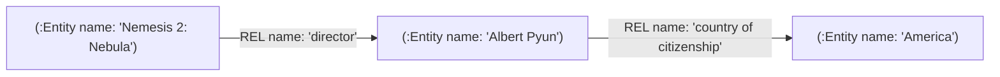
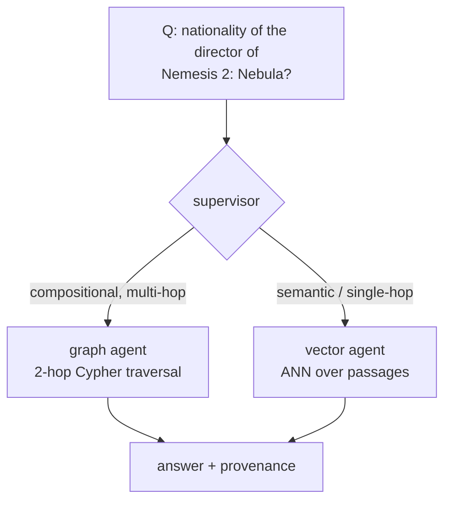

# Data schema

Two stores, populated from the same `data/processed/` artifacts, serving the two
retrieval strategies the supervisor routes between.

## Neo4j (graph agent) — entities + relations

Built from `triples.jsonl` (subject-relation-object from 2WikiMultihopQA
`evidences`). Multi-hop compositional questions are answered by *traversing* these.



**Model**

| Element | Label / type | Properties |
|---------|--------------|------------|
| Node | `:Entity` | `name` (unique) — the only property; `MERGE` sets just this |
| Edge | `:REL` | `name` (the Wikidata relation, e.g. `director`, `mother`) |

(The sha1 `id` in the ingest code is the **passage** id — the Qdrant point/payload key,
not a graph-node property.)

**Why a generic `:REL` type with a `name` property** (not a distinct type per
relation): Cypher cannot parameterize a relationship *type* in a plain `MERGE`
(you'd need APOC). A single `:REL` type keeps ingestion dependency-free and
idempotent, and the text-to-Cypher prompt simply tells the LLM the schema:
`(:Entity)-[:REL {name}]->(:Entity)`.

**Constraints** (idempotent, MERGE-safe):
```cypher
CREATE CONSTRAINT entity_name IF NOT EXISTS
FOR (e:Entity) REQUIRE e.name IS UNIQUE;
```

**A 2-hop query** ("nationality of the director of Nemesis 2: Nebula"):
```cypher
MATCH (film:Entity {name: 'Nemesis 2: Nebula'})-[:REL {name: 'director'}]->(dir)
MATCH (dir)-[:REL]->(nat)
RETURN dir.name, nat.name;
```

## Qdrant (vector agent) — passage embeddings

Built from `passages.jsonl` (unique Wikipedia paragraphs). Semantic questions and
single-hop lookups are answered by nearest-neighbour search.

| Field | Value |
|-------|-------|
| Collection | `provenance` (configurable) |
| Vector size | 1536 (`text-embedding-3-small`) |
| Distance | Cosine |
| Payload | `title`, `text`, `passage_id` |

One passage = one point (paragraphs are short Wikipedia intros, so no further
chunking needed for this corpus).

## eval.jsonl (RAGAS)

Not a store — the evaluation ground truth. Each row: `question`, `answer`,
`type`, `supporting_titles` (gold passages, for retrieval hit-rate), and
`evidence_triples` (the gold reasoning path).

## How the two stores prove the thesis



Flat vector RAG struggles with the multi-hop case because the two facts (film→
director, director→nationality) live in different passages that rarely co-occur
in one chunk. The graph traversal makes that link explicit — the measurable win
we quantify in the eval (graph+routing vs flat-vector baseline).
