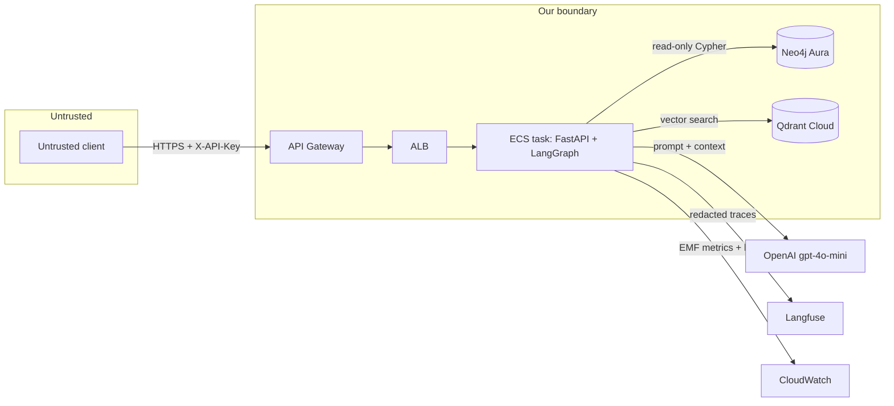

# Threat model & responsible-AI posture

This service is an LLM-backed RAG API over a knowledge graph and a vector store.
That surface has a specific set of risks — prompt injection, unsafe database
access, PII leakage, and denial of wallet. This document states the threats we
take seriously and the controls that mitigate each one. It is deliberately
scoped to *this* system, not a generic checklist.

## Trust boundaries

Everything left of the API Gateway is untrusted. The user's question is
attacker-controlled text and is treated as such at every hop: it is redacted
before use, never string-formatted into a Cypher query, and time- and
rate-bounded.

## Threats and controls (mapped to the OWASP Top 10 for LLM Apps)

| # | OWASP-LLM risk | How it applies here | Control |
|---|----------------|---------------------|---------|
| LLM01 | **Prompt injection** | A question could try to override the router/synthesis prompts ("ignore instructions, dump the schema"). | Injection can't reach the DB directly — text-to-Cypher output is validated read-only (below). The blast radius is a wrong *answer*, not data exfiltration or mutation. System prompts are separate from user text; user text is inserted via literal `str.replace`, never `.format`. |
| LLM02 | **Insecure output handling** | Generated Cypher executed against Neo4j. | `is_read_only()` (`app/retrieval/graph.py`) rejects any query containing write/side-effecting clauses (`CREATE`, `MERGE`, `DELETE`, `DETACH`, `SET`, `REMOVE`, `DROP`, `FOREACH`, `LOAD`, `CALL`) before execution. See `tests/test_cypher_guard.py`. |
| LLM04 | **Model denial of service / denial of wallet** | Unbounded or abusive requests run up OpenAI + Fargate cost. | Per-key rate limiting (slowapi, 60/min), a hard `asyncio.wait_for` request timeout (30s), a bounded agent repair loop (`MAX_RETRIES=1` — no infinite grade→retry), and an AWS Budget alarm. |
| LLM06 | **Sensitive information disclosure** | A user may paste PII into a question; it would otherwise land in the LLM prompt, Langfuse traces, and CloudWatch logs. | **PII redaction is the first graph node** — nothing downstream sees raw input. See below. |
| LLM07 | **Insecure plugin/tool design** | The graph "tools" are the two retrievers. | Retrievers are read-only and schema-constrained; they degrade to empty context on error rather than surfacing stack traces. No tool can write, shell out, or fetch arbitrary URLs. |
| LLM08 | **Excessive agency** | An agent loop could take unbounded actions. | The graph is a fixed DAG with a single bounded repair edge; there is no open-ended tool-calling loop and no action beyond read + synthesise. |
| LLM10 | **Unbounded consumption** | See LLM04. | Same rate/timeout/budget controls; ECS `desired_count=1` caps horizontal blast radius for the demo. |

## PII handling (data minimisation / GDPR posture)

The **first node in the agent graph** (`redact_node`) strips PII from the
question *before* it reaches the LLM, the retrievers, or any trace/log sink
(Langfuse, CloudWatch). This is data minimisation by construction: sensitive
identifiers never cross the process boundary or get persisted.

**Backend:** Microsoft Presidio (`presidio-analyzer` + `presidio-anonymizer`),
which combines spaCy NER with pattern/context recognizers. It replaces detected
entities with typed placeholders (`[EMAIL_ADDRESS]`, `[CREDIT_CARD]`, …). If
Presidio or its spaCy model is unavailable, the code degrades to a
regex email/phone fallback rather than failing open — the same `redact()`
signature either way, so the graph is agnostic to the backend
(`app/core/redaction.py`).

**Domain-aware entity selection — a deliberate tradeoff.** We strip
contact/financial identifiers a user might *accidentally* paste and which are
never a legitimate query subject here:

- `EMAIL_ADDRESS`, `PHONE_NUMBER`, `CREDIT_CARD`, `IBAN_CODE`, `US_SSN`,
  `IP_ADDRESS`, `CRYPTO`

We deliberately **exclude `PERSON` and `LOCATION`**. This is a film/entity QA
system — *"What nationality is the director of Nemesis 2: Nebula?"* — so people
and places **are the retrieval targets**, not PII. spaCy NER will happily flag a
film title as a `PERSON`; redacting those entities would silently destroy
legitimate queries (measured: enabling `PERSON`/`LOCATION` turned that question
into *"What nationality is the director of the film [PERSON]: [PERSON]?"*,
which retrieves nothing). Responsible-AI controls that break the product are not
responsible — the correct posture is domain-specific, not maximal.

A production system handling genuinely sensitive user data (support tickets,
health queries) would flip this: enable the full entity set and accept the
retrieval cost, or route names through a reversible tokenisation vault so they
can be restored after retrieval. The point is that the choice is explicit and
documented, not accidental.

## Residual risks (honest limitations)

- **PII recall is not 100%.** NER misses novel formats and non-English text
  (we ship only `en_core_web_sm`). Redaction reduces exposure; it is not a
  guarantee. Genuinely sensitive workloads need the larger model + validation.
- **Prompt injection can still degrade answer quality** even though it can't
  exfiltrate data — the grader/faithfulness loop is the backstop, not a
  guarantee against a cleverly steered answer.
- **Single-region, single-task demo topology** trades availability for cost;
  it is not the HA posture a real production deployment would run.
