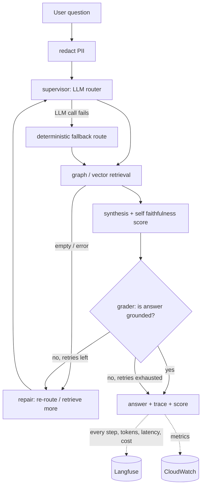
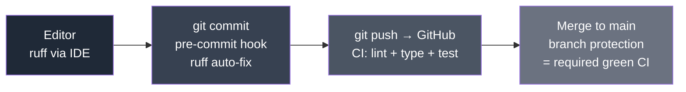
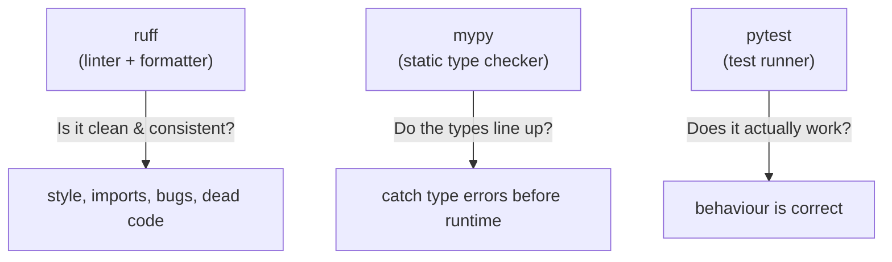
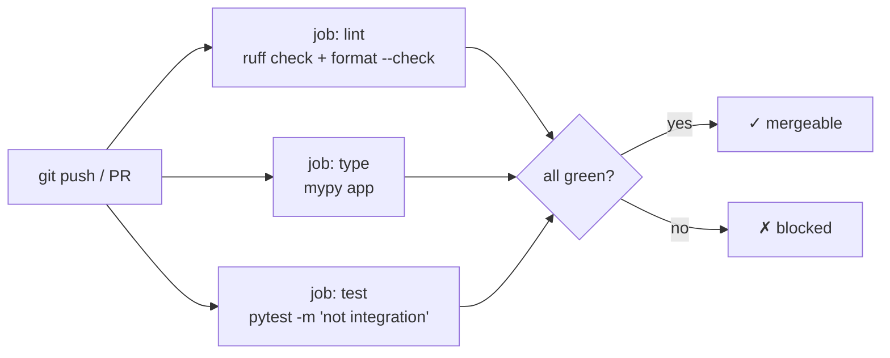

# ProvenanceAgent — Learning Log

> A living, lecture-style companion to this project. This is the *why* behind
> every decision — the document I study from and revise as the project grows.
> `plan.md` is *what to build*; this is *what I learned building it*.

Each phase adds:
1. **What we did** — the concrete deliverables.
2. **How we did it** — the commands, the code, the mechanics.
3. **Why we did it** — design choices, trade-offs, methodologies.
4. **Concept diagrams** — Mermaid, to make the ideas click.
5. **Lessons Learnt / Iterations** — the mishaps, errors, and course-corrections.
   *(This section is gold for interviews: it proves I can debug and reason, not
   just follow a happy path.)*

There is also a growing **Cross-Cutting Concepts** section for the big ideas that
span every phase.

---

# Table of contents

- [Cross-Cutting Concepts](#cross-cutting-concepts)
  - [C1. Why error handling & evaluation are *the* differentiators in LLM systems](#c1-why-error-handling--evaluation-are-the-differentiators-in-llm-systems)
- [Phase 0 — Foundations & Repo Hygiene](#phase-0--foundations--repo-hygiene)

---

# Cross-Cutting Concepts

## C1. Why error handling & evaluation are *the* differentiators in LLM systems

Two quotes from `PORTFOLIO_PLAN.md` frame the whole project:

> *"Un modello in produzione che nessuno guarda è un debito, non un asset."*
> *"It works on my machine doesn't apply to LLMs."*

These point at the two disciplines that separate a demo from a production system.

### Evaluation — because an LLM can be *fluently, confidently wrong*

Traditional software is **deterministic**: a function returns the right value or
throws. You can read the output and know. An LLM breaks both assumptions:

- It can produce a **beautifully-worded, plausible, completely false** answer
  (hallucination). Nothing crashes; nothing *looks* wrong.
- A prompt that works on the 5 examples you tried by hand can silently fail on
  the 6th. You cannot eyeball quality at scale.
- **You cannot improve what you cannot measure.** Is prompt v2 better than v1?
  Is `gpt-4o-mini` enough, or do we need a bigger model? Does the graph agent
  actually beat flat vector RAG? Without numbers these are just opinions.

So **evaluation converts subjective "seems good" into objective, tracked metrics**,
and — crucially — runs them **in CI**, so every commit is measured the way unit
tests measure logic. That is the "evaluation obsession" recruiters ask for.

### Error handling — because a model nobody watches is a *debt*

LLM systems have a far larger failure surface than ordinary code:

| Failure mode | Example |
|---|---|
| Upstream instability | OpenAI timeout, rate-limit (429), transient 500 |
| Malformed model output | asked for JSON, got prose |
| Empty / bad retrieval | no graph path found; vector search returns junk |
| Infrastructure | Neo4j / Qdrant connection drops |
| Adversarial input | prompt injection into text-to-Cypher; PII in logs |
| Runaway behavior | an agent retry-loop that never terminates; cost blowout |

Because these are often **intermittent** (non-determinism), you also need
**tracing** to reproduce them. Error handling and observability are two halves of
one discipline: catch it, degrade gracefully, and leave a trail you can replay.

### How ProvenanceAgent bakes both in



- **Evaluation:** RAGAS in CI (faithfulness / answer-relevance / context
  precision-recall) with a build-failing threshold; a flat-vector **baseline** to
  quantify the multi-hop lift; Langfuse traces + MLflow experiment history.
- **Error handling:** a **grader node** + **bounded retry** (`max_retries`), a
  **deterministic router fallback**, **read-only + validated** text-to-Cypher,
  API-level timeouts / error envelopes / `/ready`, PII redaction, cost alarms.

The elegant part: the runtime **grader** and the offline **RAGAS faithfulness**
metric ask the *same question* — "is this answer actually supported by what we
retrieved?" One protects a single request; the other protects every future commit.

*(Implementation lands in Phases 1, 3, and 5 — this section will gain concrete
code references as we build.)*

---

# Phase 0 — Foundations & Repo Hygiene

**Goal:** before a single feature, turn a folder of files into a *real,
gated, reproducible* software project. None of this is glamorous. All of it is
what "production-grade Python" in the job postings actually means.

## 0.0 The mental model: defense in depth for code quality

We never trust a single checkpoint. The same quality checks run at **three**
increasingly authoritative layers, so a problem is caught as early (and as
cheaply) as possible:



- **Fast + local** (pre-commit): catches style before it enters history.
- **Authoritative + remote** (CI): runs with the *real* dependencies on the
  *deployment OS* (Linux), so "works on my machine" cannot hide.
- **Enforced** (branch protection): nothing merges to `main` unless CI is green.

Why bother for a solo project? Because the whole point of this repo is to *prove*
the production half of the job. The gates **are** part of the portfolio.

## 0.1 Version control: git + GitHub

**What:** initialised the repo, made an initial commit of the scaffold, created a
private GitHub repo, and pushed.

**How:**
```bash
git init -b main
git config user.name "munyaradzi-zhou"
git config user.email "munyaradzizhou11@gmail.com"
# ... stage, then first commit ...
gh repo create provenance-agent --private --source=. --remote=origin --push
```

**Why these choices:**
- **`main` as the default branch** — modern convention.
- **Private first, public later** — the repo is a stub right now; recruiters
  shouldn't stumble on it half-built. We flip to public once it tells a story.
- **`gh` CLI over the web UI** — scriptable, reproducible, and it wires the
  `origin` remote in one step.

**What must NEVER be committed** (enforced by `.gitignore`):
- `.env` — real secrets (API keys). Only `.env.example` (placeholders) is tracked.
- `data/raw/*.json`, `*.zip` — the 247 MB corpus. Large binaries bloat git
  forever (git keeps every version). These are **DVC**-tracked later instead.
- `venv/`, `__pycache__/`, `mlruns/`, caches.

## 0.2 Dependency hygiene: runtime vs dev split

**What:** split one `requirements.txt` into two.

| File | Contains | Ships in Docker image? |
|---|---|---|
| `requirements.txt` | fastapi, uvicorn, langgraph, langchain, neo4j, qdrant-client, langfuse | ✅ yes |
| `requirements-dev.txt` | ruff, mypy, pre-commit, pytest, **ragas, mlflow, dvc** | ❌ no |

**Why:** the serving container should contain *only what it needs to serve*.
`ragas` and `mlflow` are heavy and only run **offline / in CI** (evaluation and
experiment tracking), not inside the live API. A leaner image = faster deploys,
smaller attack surface, lower cost. `requirements-dev.txt` starts with
`-r requirements.txt`, so `pip install -r requirements-dev.txt` gives developers
everything.

> **Methodology:** "runtime vs dev vs eval" dependency separation is a standard
> production pattern. It maps directly to the multi-stage Docker build in Phase 4.

## 0.3 Code quality gates: ruff, mypy, pytest

Three tools, three different questions:



- **ruff** — an extremely fast (Rust) linter *and* formatter. It replaces the old
  `black + isort + flake8` stack with one tool. We enabled rule families for
  pyflakes (`F`), import sorting (`I`), pyupgrade (`UP`), bugbear (`B`),
  comprehensions (`C4`), and simplify (`SIM`).
- **mypy** — static type checking. Python is dynamically typed, but type hints +
  mypy catch a whole class of bugs (passing the wrong type, forgetting a return)
  *before* the code runs. We run **strict-ish** (`disallow_untyped_defs`), but
  pragmatic (`ignore_missing_imports` for untyped libs like langchain).
- **pytest** — the test runner. We added a `integration` marker to separate fast
  unit tests from ones that need docker-compose (Neo4j + Qdrant) up.

**Key decision — target Python 3.11, not 3.13:** the local venv is 3.13, but the
Docker image and CI run **3.11**. We pinned ruff and mypy to `py311` so they flag
anything that would break *in production*, not just locally. Test the deployment
target, not the dev box.

## 0.4 `pyproject.toml` — one config to rule them all

**What:** a single `pyproject.toml` holds config for ruff, mypy, and pytest.

**Why:** the modern Python standard (PEP 518/621). One file instead of
`.flake8` + `setup.cfg` + `pytest.ini` + `mypy.ini`. Easier to read, less clutter.

## 0.5 Automating the gates: pre-commit + CI

**pre-commit** runs the fast checks automatically on `git commit`:
```bash
pre-commit install          # one-time: wires .git/hooks/pre-commit
```
After a lot of iteration (see Lessons Learnt), the hook config ended up as
**native ruff hooks only** — lint + format in ~2s.

**CI** (`.github/workflows/ci.yml`) is the authoritative gate: three parallel jobs
— `lint`, `type`, `test` — each on a clean Ubuntu runner with the *real*
dependencies:



**Why split into parallel jobs?** Faster feedback (they run concurrently) and a
clear signal — you see *which* dimension failed (style vs types vs behaviour) at a
glance.

**Division of labour (important design choice):**
- **pre-commit = fast, local, formatting.** Native ruff only. Runs every commit.
- **CI = slow, authoritative, complete.** ruff *and* mypy (with full deps) *and*
  pytest. mypy lives here, not in pre-commit — see Lesson L4.

## 0.6 Task runners: `tasks.ps1` + `Makefile`

**What:** wrapper commands so I never memorise long invocations.
```powershell
.\tasks.ps1 setup   # install dev deps + git hooks
.\tasks.ps1 check   # lint + type + test (everything CI runs)
.\tasks.ps1 fmt     # auto-format + auto-fix
```
**Why two files?** Windows has no `make`. `tasks.ps1` is the daily driver here;
the `Makefile` mirrors it for Linux/CI and doubles as documentation.

## 0.7 Line endings: `.gitattributes`

**What:** `* text=auto eol=lf` (plus explicit rules) so every text file is stored
as **LF** in the repo.

**Why:** I develop on Windows (CRLF); CI runs on Linux (LF). Without
normalisation, git reports spurious "whole file changed" diffs and warns
`LF will be replaced by CRLF` on every `git add`. `.gitattributes` makes the repo
canonical (LF) regardless of OS. `.ps1` files are pinned to CRLF (PowerShell
prefers it).

---

## Lessons Learnt / Iterations — Phase 0

> The happy path is boring and forgettable. These are the moments the project
> pushed back — and what I changed. Each is an interview-ready story.

### L1 — `gh` push rejected: OAuth token missing `workflow` scope
**Symptom:**
```
! [remote rejected] HEAD -> main (refusing to allow an OAuth App to create or
update workflow `.github/workflows/ci.yml` without `workflow` scope)
```
**Why:** GitHub protects Actions workflows. A token can hold `repo` scope yet
still be forbidden from *creating workflow files* — that needs the separate
`workflow` scope, by design (a compromised token shouldn't be able to inject CI).
**Fix:**
```bash
gh auth refresh -h github.com -s workflow   # one-time browser device-code approval
```
**Takeaway:** OAuth scopes are **least-privilege**. "It can push code" ≠ "it can
push CI config." Know the difference.

### L2 — `.gitignore` couldn't re-include `data/raw/README.md`
**Symptom:** I wanted to ignore the big corpus files but keep a README in the same
folder. `data/raw/` + `!data/raw/README.md` did **not** work — the README stayed
ignored.
**Why:** a git rule — *"it is not possible to re-include a file if a parent
directory of that file is excluded."* A trailing-slash pattern (`data/raw/`)
excludes the whole directory, and no `!` negation inside it can rescue a file.
**Fix:** ignore the *files*, not the directory:
```gitignore
data/raw/*.json
data/raw/*.zip
```
**Takeaway:** `.gitignore` directory-exclusion vs file-exclusion is a real,
bite-you-later distinction.

### L3 — Committing to the linters: the scaffold wasn't formatted
**Symptom:** first `ruff check` / `ruff format --check` failed on 9 files
(unsorted imports, missing blank line after module docstrings, over-long
manually-wrapped calls).
**Fix:** `ruff check --fix` + `ruff format` auto-resolved everything; re-ran to
confirm clean.
**Takeaway:** adopting a formatter *after* code exists always produces one big
"reformat everything" diff. Do it early. From now on the gate keeps it clean.

### L4 — mypy in pre-commit: slow *and* wrong
**Symptom:** with `mirrors-mypy` as a pre-commit hook, `git commit` took **~2.5
minutes** and the type results didn't match my manual run.
**Why (two problems):**
1. The pre-commit mypy runs in an **isolated environment** that only has
   `mypy + pydantic` — *not* our real deps (langgraph, neo4j...). So it analyses
   different code than the real thing → inaccurate.
2. Spinning that isolated interpreter up on every commit is slow.
**Fix:** removed mypy from pre-commit; it now runs **only in CI** (full deps,
authoritative) and locally on demand via `.\tasks.ps1 type`.
**Takeaway:** put a check where it can run *correctly*. Type-checking needs the
real dependency graph, so its natural home is CI, not an isolated commit hook.

### L5 — mypy choked on numpy's stubs (3.12 syntax under a 3.11 target)
**Symptom:**
```
numpy/__init__.pyi: error: Type statement is only supported in Python 3.12 and greater
```
**Why:** a transitive dep (numpy, via ragas/langchain) ships `.pyi` stubs using
3.12+ syntax, but we pinned mypy to `python_version = 3.11`. mypy followed into
numpy and tripped. We don't even import numpy directly.
**Fix:** tell mypy not to follow into it:
```toml
[[tool.mypy.overrides]]
module = ["numpy.*", "pandas.*"]
follow_imports = "skip"
```
**Takeaway:** static analysis can fail on code *you don't own*. `follow_imports`
and `ignore_missing_imports` are the escape hatches for third-party noise.

### L6 — real type errors the scaffold was hiding
Once mypy actually ran, it found two genuine issues:
- `route = "both" if ... else "vector"` was typed `str`, but the state field is
  `Literal["graph","vector","both"]`. Fixed by annotating
  `route: Literal[...]` (and importing `Literal`).
- `build_graph()` had no return type. Fixed with
  `-> CompiledStateGraph` (imported from `langgraph.graph.state`).
**Takeaway:** types aren't bureaucracy — mypy immediately surfaced a latent
type-safety gap in code that "ran fine."

### L7 — the big one: `git commit` hung for minutes (Windows + pre-commit)
**Symptom:** `git commit` timed out at 2, 3, even 4 minutes. `time` showed the
smoking gun: **~2.5 min wall clock but ~0.4 s CPU** — the process was *waiting*,
not computing.
**Root cause (layered):**
1. First commit triggered pre-commit's **one-time environment build** (cloning
   hook repos, building venvs) — genuinely slow.
2. Killing those timed-out commits left **zombie git/python processes** holding
   resources, which compounded every retry.
3. The generic `pre-commit-hooks` (trailing-whitespace, end-of-file-fixer,
   check-yaml, check-added-large-files) each **spawn a fresh isolated Python
   interpreter**, which **Windows Defender re-scans on every spawn** → ~20 s
   each, ~80 s+ per commit. (ruff, a native binary, was always ~3 s.)
**Fixes, in order:**
- Pre-built hook envs out-of-band (`pre-commit install-hooks`) so the build
  wasn't inside the commit.
- Killed the zombie processes (`taskkill //F //IM git.exe`) and cleared
  `.git/index.lock`.
- **Redesigned the hook config to native ruff hooks only.** The dropped hooks'
  value is already covered: `ruff-format` handles trailing whitespace + final
  newlines on `.py`; `.gitattributes` handles line endings; `.gitignore` + review
  keep large files out. Result: **commits went from 2.5 min → ~2 s.**
- One commit was made with `--no-verify` to unblock while diagnosing, since the
  hooks were *stalling* (not failing) and all gates were already verified green
  manually + in CI.
**Takeaway:** performance bugs aren't only in your code — the *toolchain* and the
*OS* (here, Defender scanning many small interpreter spawns) are fair game.
`user` vs `real` time in `time` output instantly tells you "computing" vs
"waiting." And: match a tool's cost to its value — a 3 s native hook earns its
place on every commit; a 20 s interpreter spawn does not.

### L8 — branch protection blocked on GitHub Free (private repo)
**Symptom:** `gh api ... /branches/main/protection` →
`403: Upgrade to GitHub Pro or make this repository public`.
**Why:** GitHub Free only offers branch protection on *public* repos.
**Decision:** deferred, not abandoned. CI still runs on every push; enforcement
switches on automatically when we flip the repo to public. Documented in `plan.md`.
**Takeaway:** know your platform's plan limits; have a graceful fallback and
record the deferral instead of silently dropping the requirement.

---

## Phase 0 — Exit state

| Item | Status |
|---|---|
| git repo on `main`, authored, pushed | ✅ |
| Private GitHub repo + `origin` remote | ✅ |
| Corpus (2WikiMultihopQA) downloaded, gitignored, documented | ✅ |
| `requirements.txt` / `requirements-dev.txt` split | ✅ |
| `pyproject.toml` (ruff + mypy + pytest) | ✅ |
| pre-commit (native ruff, ~2 s/commit) | ✅ |
| CI: lint + type + test, all green | ✅ |
| `tasks.ps1` + `Makefile` | ✅ |
| `.gitattributes` (LF normalization) | ✅ |
| Branch protection | ⏸ deferred to public flip |

**Command cheat-sheet learned this phase:**
```bash
git init -b main                      # new repo, main default
gh repo create <name> --private --source=. --push
gh auth refresh -h github.com -s workflow   # add a token scope
ruff check --fix app tests            # lint + autofix
ruff format app tests                 # format
mypy app                              # type-check
pytest -q -m "not integration"        # fast tests
pre-commit install                    # wire the git hook
pre-commit install-hooks              # pre-build hook envs (avoid slow first commit)
pre-commit run --all-files            # run hooks manually
git commit --no-verify                # bypass hooks (use sparingly, when justified)
time ( <cmd> )                        # real vs user time = waiting vs computing
```

**Next:** Phase 1 (agentic core) + Phase 2 (data ingestion — the critical path).
